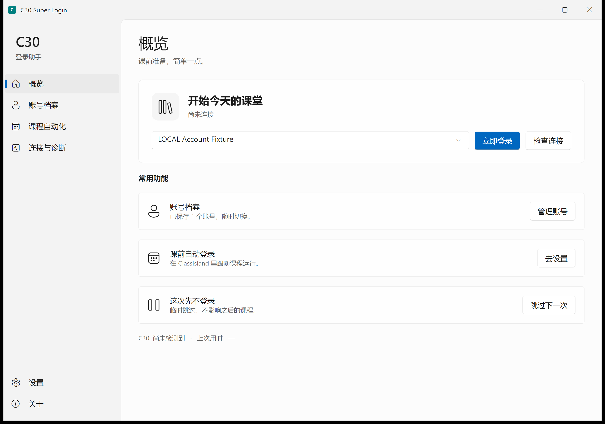
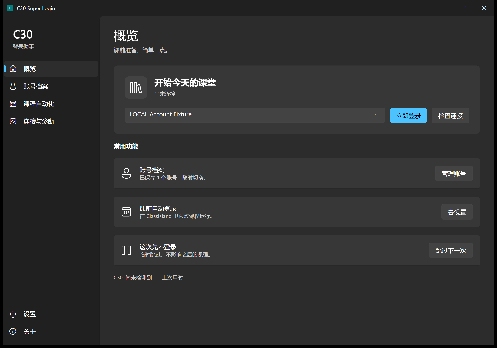
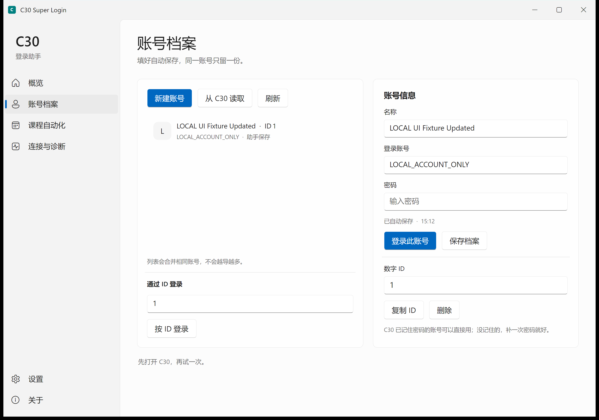
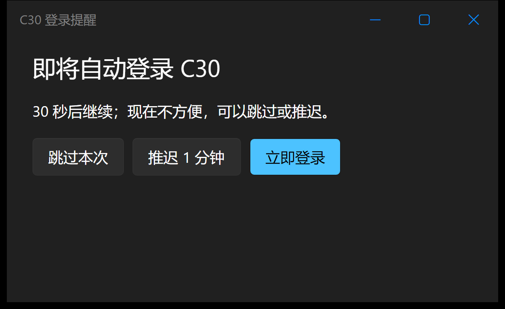
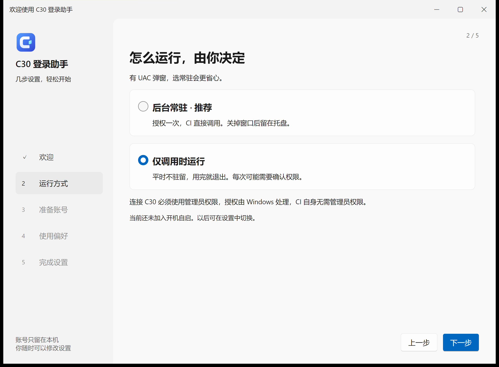
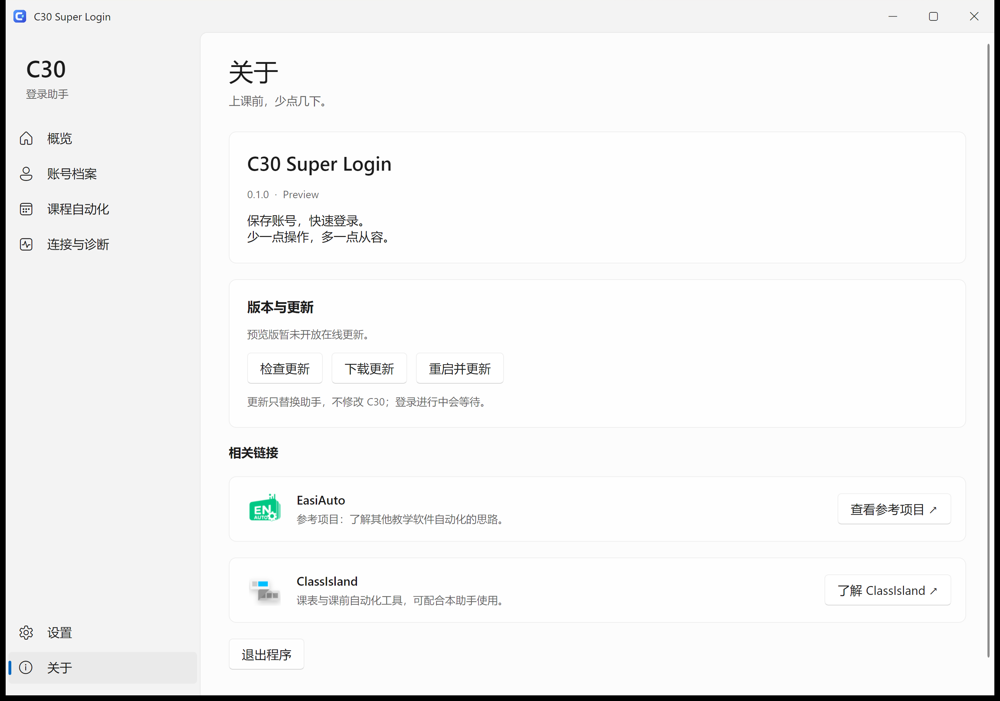

# C30 Super Login · 0.1.0 preview

保存账号，课前快速登录。支持账号 ID 调用、ClassIsland 自动化，以及跟随系统的浅色 / 深色界面。无 OCR，无常驻横幅。

> 当前为预览版：真实 C30 认证仍待验收，生产遥测和在线更新服务尚未上线。请先读下面的验证边界，不要把“已提交请求”理解为“已经登录成功”。仅支持 C30，不包含希沃白板。

## 下载

[查看最新发行版及更新说明](../../releases/latest) · [直接下载最新安装包](../../releases/latest/download/C30SuperLogin-Setup.exe) · [校验文件](../../releases/latest/download/SHA256SUMS.txt)

这些 GitHub 链接在仓库首次发布 Release 后生效；本地构建不会自动发布到 GitHub。

- 推荐：`C30SuperLogin-Setup.exe`，Velopack 安装包，自带运行环境。
- `C30SuperLogin-win-Portable.zip`：Velopack 生成的便携包，自带运行环境；请整包解压。
- 开发用 `C30SuperLogin-0.1.0-win-x64.zip`：需要自行安装 .NET 10 Desktop Runtime，不是前两者。
- 适用系统：Windows 10 / 11 x64。每个 Release 同时提供更新说明、更新索引及 SHA-256 清单。

## 界面预览

下面均为助手真实窗口，使用合成测试账号，不含真实教学账号。

| 浅色 | 深色 |
| --- | --- |
|  |  |









## 当前验证边界

- 适配身份：C30 **1.3.1610.0**，DuiLib SHA-256 `15C4E6674A3BF0BB746449459E3E0A03741F933840438DEE3C68F2C2B6433980`。不匹配即停止注入。
- 自有 x86 进程已实测 DLL 钩子加载、在目标 UI 线程调用 ExecJS。本轮核心 70 项、注入脚本 17 项、账号 CLI 14 项和桌面更新/后台通信 24 项检查通过；不等价于真实账号认证。
- 真实 C30 无账号探测的结果为 **access_denied / Windows 错误码 5**，不是注入成功；请确认助手与 C30 运行权限一致后再测。
- **未验证真实账号认证、真实 ClassIsland 定时触发或生产遥测服务接收。** 页面回执 `submitted` 只表示已交给原登录桥，不代表认证成功。手动本地激活仅修改当前 C30 进程内存，不写安装文件、许可证或云端绑定；重启 C30 后失效，本轮未验收该操作。

## 运行

推荐运行安装包，按提示完成安装，再打开助手。安装包不要求额外安装 .NET。

### 首次设置与运行方式

第一次打开是五步引导：欢迎 → 运行方式 → 准备账号 → 使用偏好 → 完成。左侧显示进度，底部保留上一步 / 下一步，不必先进入主页面再补配置。

- 账号页可读取 C30 已保存账号，也会显示助手已有档案；新建或补填密码自动加密保存、自动去重，分配短数字 ID。
- 同一页可一键检测 C30 目录和版本，或展开安装位置手动选择。暂时没有账号时可明确选择「稍后配置账号」。
- 使用偏好包含主题、课前提醒、两项默认开启的上报、自动检查更新、按需打开 C30，以及可选的 ClassIsland 课程绑定与配置导出。
- 引导中保存过的账号会保留；以后可在「设置」切换运行方式或重新打开引导。

| 方式 | 怎么用 |
| --- | --- |
| 后台常驻 | 连接时正常申请管理员权限，授权后留在本次登录会话的后台。CI / ClassIsland 复用后台，关闭主窗口只收进托盘。开启 UAC 弹窗的电脑推荐这一项。 |
| 仅调用时运行 | 平时不驻留；CLI 调用时启动并按需申请管理员权限，操作结束后退出。开启 UAC 的电脑可能每次都要确认；手动打开的主窗口关闭即退出。 |

连接 C30 **必须使用管理员权限**，引导和设置都没有关闭选项；旧配置中的关闭值会自动忽略。CI 自身不必以管理员运行：界面保持普通启动，连接时通过 Windows 正常授权。是否弹窗由系统决定，程序不修改或绕过 UAC。取消授权不会偷偷登录，也不会换一种方式重复提交。

当前的“常驻”仅指本次 Windows 登录会话，**还未添加开机自启、计划任务或系统服务**。真正的 UAC 授权及普通进程到管理员后台的连接仍待实机验收；已验证的是隔离环境中的运行偏好、界面生命周期和自有管道夹具。

「关于」底部的「相关链接」说明了每个外部项目的用途：EasiAuto 是参考项目，ClassIsland 用于课表和课前自动化。在线更新暂未开放时会直接说明，不把未配置显示为“已是最新版本”。

完整解压 `C30SuperLogin-0.1.0-win-x64.zip`，运行 `C30SuperLogin.exe`。框架依赖版，需要 **Windows x64 + .NET 10 Desktop Runtime**；不是单文件或免运行库版。x86 辅助程序使用静态 C++ 运行库。

1. 「连接与诊断」会自动查找安装目录，也可点「立即检测目录」。先手动打开 C30 的账号登录页；识别不到时可保存手动位置。
2. 点击「检查注入连接」。错误码 5 表示 Windows 拒绝当前消息/注入访问；需要匹配实际运行权限，而不是重复尝试旧地址。
3. 「账号档案」填写后自动保存，也可读取 C30 已记住的账号；同一账号合并为一份，档案 ID 保持稳定。账号和密码由当前 Windows 用户的 DPAPI 加密；换电脑/用户后需要重新保存。
4. 连接成功后再提交自己的有效账号。错误密码、断网和服务端认证结果仍由 C30 原流程处理。
5. 关闭窗口进入托盘；双击托盘图标恢复。通过托盘菜单或「关于 → 退出程序」完全退出。

默认数据目录 `%LOCALAPPDATA%\C30SuperLogin`。档案显示名称是普通本地元数据，不要在显示名称中填写密码。日志轮转、待上传事件上限 64 条。

### 账号怎么用

- 新账号：进入「账号档案 → 新建账号」，填登录账号和密码；停一会儿会显示“已自动保存”。名称选填，之后可以不再输入密码。
- C30 原来记住的账号：先打开 C30 登录页，再点「从 C30 读取」。助手只读取账号元数据和引用，不导出原密码；没记住密码的账号需补填一次。
- 同一账号重复添加或导入会合并，保留原档案 ID；已有课程绑定不会因为重复导入而换成新 ID。
- 数字 ID 自动从 `1、2、3…` 分配，不用填写长串字符。在 ClassIsland / 自动化里写 `login --id 1` 即可；导出的配置也会自动使用数字 ID。编号只属于本机助手，不是手机号或教师编号。
- 已有账号会自动补上短编号，旧的长 ID 仍可调用。改名、重复导入不换号；删除后的号码不分配给其他账号，避免旧自动化误登。
- 删除会移除本机加密凭据及对应课程绑定，不会删除 C30 里的账号。

### 登录方式与运行前提醒

| 顺序 | 方式 | 何时使用 |
| --- | --- | --- |
| 1 | x86 注入原登录页面 | 首选，复用 C30 原桥和认证流程；速度以实际测量为准 |
| 2 | Windows 页面控件 | 第一种明确未提交、且存在匹配的账号 / 密码 / 按钮控件时；不靠坐标或 OCR |
| 3 | 手动登录提示 | 两种自动方式均未提交时提醒用户回 C30 操作；不是第三种自动认证方案 |

已排队或已开始点击但结果不明确时停止，不继续切换或重复提交。未知版本、多个运行版本、账号缺失等情况也会先停止。

每次方式切换记录顺序、当前 / 上一种方式、原因、用时及 C30 版本；本地见 `strategies.jsonl`，CLI 和界面均会交给上报队列。不会上传账号、密码或页面内容。生产服务仍待配置。

ClassIsland 触发的自动登录默认提前 **5 秒**提醒，可「立即登录」「跳过本次」「推迟 1 分钟」。推迟后窗口隐藏，到时再提醒。设置中可以改为 10 秒或关闭提醒。手动点登录不加倒计时，也不显示常驻横幅。

### 助手更新

选择 **Velopack 1.2.161 官方 SDK + 同版本打包工具**，不自行编写覆盖 EXE 的更新脚本。

- 默认后台检查，发现更新后提示；在「关于」检查、下载，再由你选择「重启并更新」。不会下载后立即打断上课。
- 登录或提醒任务进行中拒绝更新重启；账号留在独立数据目录，更新不替换 C30 安装文件。
- 已关闭 SDK 默认的“启动时自动应用已下载更新”，防止 ClassIsland 启动登录任务时顺便重启助手。
- 官方安装包在构建时嵌入本仓库的 GitHub Release 下载地址；自部署可设置 `C30_UPDATE_URL` 为 HTTPS 更新目录。地址为空时显示“预览版暂未开放在线更新”，不假装已是最新版。
- 已通过官方 `TestVelopackLocator` 的本地更新发现、下载与校验检查；**尚未进行真实安装后的升级、回退或生产更新源验收**。本地安装包未签名。

### 遇到杀毒告警

本程序包含原生注入模块，可能触发安全软件告警；尚无正式杀毒兼容性结论，不把所有告警直接认定为误报。请先停止运行，确认来自本仓库 Release 并核对 SHA-256，再把告警名称和文件哈希提交维护者 / 杀毒厂商复核。不要上传账号数据；文档不把关闭防护或添加排除项作为安装步骤。

## 目录和版本

- 每次连接、登录或读取状态前重新检查；不固定使用 `1.3.1610.0` 的目录。优先识别正在运行的安装位置，再看已保存位置、系统常见目录和安装登记信息。
- 扫描版本号目录中的 `teach.exe` 与 `DuiLib.dll`，按版本号数值排序。新建版本文件夹或更换其内部层级后，下次操作即可识别；缺少主体或模块的目录会跳过。
- 分别保留「正在运行」「已安装最新」「启动器记录」信息。新版本已安装但旧版仍在运行时提示重启，不强行关闭课堂窗口；同时运行多个版本时停止操作。
- 新版仍须通过版本及模块哈希核对才注入，**识别到新版不等于已经适配新版**。目前未确认官方在线更新接口；这里的最新指本机已安装版本，不代表联网追踪官方最新版。

## 使用统计和错误报告

**两者默认开启**，错误分别尝试发送；任一路返回 HTTP 2xx 才记为该路 `sent`。这表示服务端接受 HTTP 请求，不等价于已在控制台检索到该事件。

两个开关默认开启，用户关闭后会保留选择。界面不展示服务商、项目 Key 或 DSN。当前尚未通过 MCP 创建生产项目；空配置真实返回 `not_configured`，不表示已经上传。

部署配置通过环境变量提供，不放进日常页面：

```powershell
$env:C30_POSTHOG_HOST = 'https://us.i.posthog.com' # 按你的项目区域/自建域名修改
$env:C30_POSTHOG_KEY = 'PROJECT_KEY'
$env:C30_SENTRY_DSN = 'DSN'
.\C30SuperLogin.exe
```

- PostHog：`/capture/`，功能事件、耗时、随机安装标识；关闭人物档案、GeoIP 功能。
- Sentry：`/api/<project>/envelope/`，注入/应用错误及测试事件。单路失败不压制另一路。
- 允许字段：应用/C30/适配器版本、枚举阶段及原因码、Win32 错误码、耗时和系统架构。
- 不发送账号、密码、令牌、班级/课程信息、页面文本、原始异常、截图、录屏、内存转储。无需把 C30 安装包上传到遥测服务。
- 出站默认只允许 HTTPS、不跟随重定向。连接服务仍会向接收端暴露通常的网络源 IP；未宣称网络匿名。
- GUI 后台每分钟重试限量待发事件；任一路成功后移除该事件。CLI 每次操作执行有界发送尝试，历史待发事件由 GUI 启动后重试。测试按钮仅报告本次发送结果。
- 当前仅为旧 HTTP 协议适配，**Sentry 官方 SDK、过滤限频、MCP 项目 / 仪表盘尚待下一阶段实施**；现有回环测试不代表已完成生产接入。

## ClassIsland

「课程自动化」导入科目或手填科目 ID，选择本机账号档案、提前秒数，再导出/合并 `Config/Automations/<配置名>.json`。合并前备份、保留其他规则、同 GUID 幂等替换。请先退出 ClassIsland，导出后在 ClassIsland 选择相应配置并实测一次课前触发。

使用公开 `classisland.os.run` 动作、`classisland.lessons.preTimePoint` 触发器和下一科目规则；上一科目排除规则避免连堂重复。命令行只携带短数字 ID，不携带账号密码。支持跳过下一次和暂停自动化。首版是配置集成，不是 ClassIsland 插件。

## CLI

```powershell
.\C30SuperLogin.exe probe --headless
.\C30SuperLogin.exe accounts list --output accounts.json
.\C30SuperLogin.exe accounts sync --headless
.\C30SuperLogin.exe login --id 1 --trigger classisland --headless
.\C30SuperLogin.exe skip-next
.\C30SuperLogin.exe status --output status.json
.\C30SuperLogin.exe detect-install --output installation.json
.\C30SuperLogin.exe telemetry-test --headless
```

`detect-install` 可供 CI 一键识别当前 C30 目录；成功后保存目录并启用后续自动识别，未找到时返回退出码 2 且保留原设置。非标准目录可加 `--candidate PATH`。WinExe 不保证已有终端能读到标准输出；`installation.json`、`last-operation.json`、`last-delivery.json` 或 `status --output` 是可靠的结果文件。`telemetry-test` 在任一路 HTTP 接受后退出 0，否则退出 2。`--data-dir PATH` 可隔离测试配置。操作结果保留 `Code`、`Win32Error`、阶段、版本和耗时。没有运行目标时可启动 C30；需提升权限时报告实际 Windows 错误，不在后台等待 UAC。

「关于」可检测授权状态、打开 C30 官方激活窗口，或手动执行「本地激活（本次运行）」。本地操作只支持校验通过的 C30 1.3.1610.0 模块和补丁字节，修改运行内存而非许可证或云端绑定，关闭或重启 C30 后失效。本轮未执行真实激活或认证验收。

## 构建与验证

需要 .NET 10 SDK、Visual Studio C++ x86 工具/Windows SDK。验证还需要 Node.js、Python 3、Git for Windows。

```powershell
.\scripts\build.ps1 -Verify
# 单独重复本地检查
python .\scripts\verify.py
# 仅打开自有 Avalonia 程序，隔离合成账号，不认证真实 C30
.\scripts\smoke-ui.ps1 -AccountChecks
.\scripts\smoke-warning.ps1
# 自带运行库的安装包、便携包和更新索引
.\scripts\package-velopack.ps1
# 不依赖厂商快照的公开 CI 脚本测试
node .\tests\test_injection.cjs --synthetic
$env:C30_UI_TEST_DARK = '1'
.\scripts\smoke-ui.ps1 -AccountChecks
```

构建输出 `artifacts/release/C30SuperLogin-0.1.0-win-x64/` 和同名 ZIP；包含可执行文件、x86 helper/agent、说明和哈希清单。**不打包 C30 原始文件、账号或本机设置。**

`audit-evidence` 的四个事务角色仅用于离线验证：`MODIFIED_FILE.js` 在原 `signin.js` 副本后追加实际运行时扩展；`DIFF_FILE.patch` 可重建该副本；`VERIFICATION.txt` 记录字面结果；自包含 `ROLLBACK.sh TARGET_COPY` 恢复原始字节。基线/回滚为 `FEATURE_ABSENT`、退出 2；修改副本为 `SUBMITTED ... authentication=unconfirmed`、退出 0。**未将副本或补丁安装到 C30。**

## 目录

- `src/`：Avalonia / FluentAvalonia 界面、加密存储、目录发现、运行时脚本及自动化。
- `native/`：x86 helper、UI 线程 agent、自有测试夹具。
- `analysis/`：初始静态分析与原件身份；`PLAN.md` 保留原计划及后续进度。
- `audit-evidence/`：可重放的副本修改、补丁、回滚及证据账本。
- `artifacts/verification/`：自有原生测试、Avalonia 窗口截图、无凭据探测结果。

## GitHub 发布

本仓库使用 `gh` 手动发布：先运行上述构建与合成夹具检查，再推送源码及 `v版本号` 标签，创建 Release 并上传 Velopack 安装包、便携包、更新索引及 SHA-256 清单。更新说明位于 `docs/release-notes/0.1.0.md`。安装包固定名为 `C30SuperLogin-Setup.exe`，上面的“直接下载最新安装包”无需随版本修改。

仓库地址：[WSXYT/C30-Super-Login](https://github.com/WSXYT/C30-Super-Login)。当前不包含自动发版 workflow。本轮本机没有可用 C++ 工具链，使用已有原生组件重新通过自有跨进程夹具，再从当前桌面源码生成安装包；不声称原生组件已重新编译。公开源码不提交 `analysis/`、`audit-evidence/`、本机数据和凭据；厂商原始源码不在仓库或发行包内。公共脚本测试使用独立合成 DOM 桩，原协议、原件哈希和事务检查仅在本机持有原件时运行。

参考说明见 `THIRD_PARTY_NOTICES.md`。公开源码或证据前请移除仅用于本机分析的 `analysis/snapshots` 和含厂商原始源码的 `audit-evidence`，不要把整份本机工作目录作为发行包。
